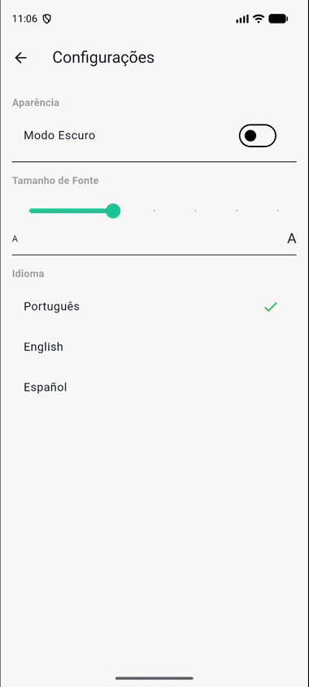
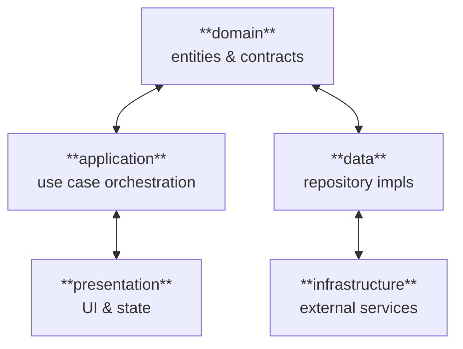
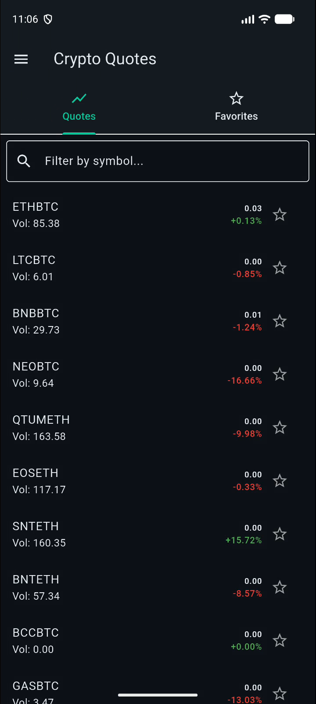
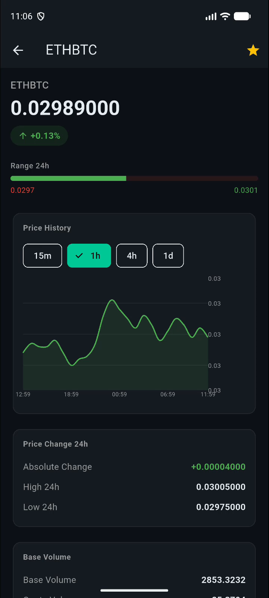
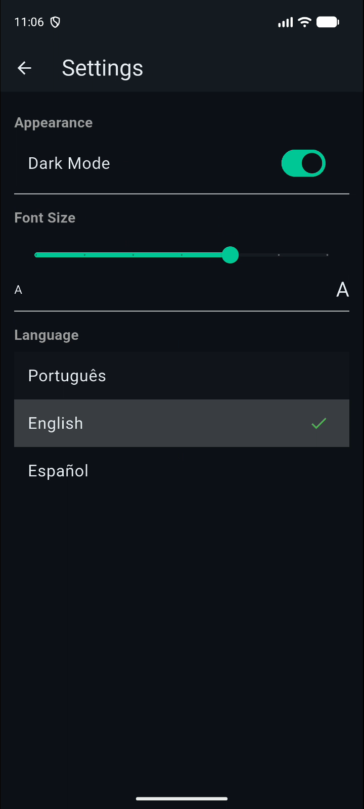

# Flutter: Clean Arch + Riverpod

A simple Flutter app built to demonstrate **Clean Architecture** in practice, using **Riverpod** for state management/DI and **AutoRoute** for navigation. It's a small crypto quotes app. Intentionally simple so the architecture, not the feature set, stays the focus.

<p align="center">
  
</p>

<sub>Screen recording of the E2E suite (`integration_test/app_test.dart`) driving the real app against the live Binance API on an Android emulator. No mockups, no hand-held demo.</sub>

## Architecture at a Glance



## Architecture: Clean Arch, DDD, Community standards, Google guidelines

Based on Evans' DDD layers, Uncle Bob's Clean Architecture rings, Flutter/Android community conventions, and Google's own Flutter architecture guidelines, all adapted and mixed to fit a Flutter app, creating an architecture that is robust, scalable, testable, and easy to maintain.

| Folder | Responsibility |
|---|---|
| `domain/` | Business rules, entities, and repository contracts |
| `application/` | Rule orchestration — use cases |
| `presentation/` | UI and state management |
| `data/` | Repository implementations — persistence for the contracts declared in `domain/` |
| `infrastructure/` | Raw external dependencies (Dio, SharedPreferences), reached only through contracts (`HttpClientInterface`, `StorageInterface`) so they can be swapped without touching repository logic |
| `core/` | Cross-cutting utilities (config, failures, l10n, theme, routing) |

---

## Folder Structure

```
/lib
├── application/                           # Use cases: orchestration between domain and data
│   ├── favorites/                            ## Favorites use cases
│   ├── preferences/                          ## Preferences use cases
│   └── quotes/                               ## Crypto quotes & klines use cases
├── core/                                  # Cross-cutting utilities shared across layers
│   ├── constants/                            ## Global constants (app config)
│   ├── failures/                             ## Domain failures, following a Result pattern
│   ├── l10n/                                 ## Internationalization (generated ARB output)
│   ├── routes/                               ## Routing (AutoRoute) and its DI
│   └── theme/                                ## App theme and colors
├── data/                                  # Data layer: access and repository implementations
│   ├── data_objects/                         ## Data transfer/mapping objects
│   │   ├── *_dao.dart                            ### Local persistence mapping
│   │   └── *_dto.dart                            ### REST API mapping
│   ├── data_sources/                         ## Data sources: API and local persistence
│   │   └── *_datasource.dart
│   └── repositories_impl/                    ## Implementations of the domain repository contracts
│       └── *_repository_impl.dart
├── domain/                                # Domain layer: business rules and contracts
│   ├── entities/                             ## Domain entities
│   └── repositories/                         ## Repository contracts
│       └── *_repository_interface.dart
├── infrastructure/                        # Infrastructure layer: external services behind contracts
│   ├── http_client/                          ## HTTP client
│   │   ├── dio/                                  ### Dio implementation (with retry interceptor)
│   │   ├── models/                               ### Internal models (ApiRoute, HttpMethod, response)
│   │   ├── http_client_failure.dart              ### HTTP layer failures
│   │   └── http_client_interface.dart            ### HTTP client contract
│   └── storage/                              ## Local persistence
│       ├── shared_preferences/                   ### SharedPreferences implementation
│       ├── storage_failure.dart                  ### Persistence layer failures
│       └── storage_interface.dart                ### Persistence contract
└── presentation/                          # Presentation layer: UI and state management
    ├── providers/                             ## State management (Riverpod)
    │   ├── */*_notifier.dart                     ### Notifiers: state logic
    │   └── */*_state.dart                        ### Possible UI states
    ├── screens/                               ## Screens
    └── widgets/                               ## Reusable widgets
```

## Dependencies

| Package | Role |
|---|---|
| [`flutter_riverpod`](https://pub.dev/packages/flutter_riverpod) / [`riverpod_annotation`](https://pub.dev/packages/riverpod_annotation) / [`riverpod_generator`](https://pub.dev/packages/riverpod_generator) | Dependency injection and state management |
| [`auto_route`](https://pub.dev/packages/auto_route) / [`auto_route_generator`](https://pub.dev/packages/auto_route_generator) | Declarative, type-safe navigation |
| [`dio`](https://pub.dev/packages/dio) | HTTP client, wrapped behind `HttpClientInterface` |
| [`shared_preferences`](https://pub.dev/packages/shared_preferences) | Local key-value persistence, wrapped behind `StorageInterface` |
| [`freezed`](https://pub.dev/packages/freezed) / [`json_annotation`](https://pub.dev/packages/json_annotation) / [`json_serializable`](https://pub.dev/packages/json_serializable) | Immutable entities/DTOs, union-type UI states, and JSON (de)serialization |
| [`dartz`](https://pub.dev/packages/dartz) | Functional `Either` for the `Result`-style failure pattern used across `core/failures` |
| [`intl`](https://pub.dev/packages/intl) / [`intl_utils`](https://pub.dev/packages/intl_utils) / `flutter_localizations` | Internationalization (`core/l10n`) |
| [`fl_chart`](https://pub.dev/packages/fl_chart) | Kline (candlestick) chart rendering |
| [`mocktail`](https://pub.dev/packages/mocktail) | Mocking for unit tests |
| `build_runner` (dev) | Code generation runner for Riverpod, AutoRoute, Freezed and json_serializable |


## Features
- Live crypto quotes list with pull-to-refresh and symbol filtering
- Quote detail screen with a candlestick (kline) chart
- Favorite/unfavorite quotes, with a dedicated favorites tab
- User preferences: dark mode, font scale, and locale
- Internationalization (English, Spanish, Portuguese)

## Screens

| Quotes list | Detail & chart | Favorites | Settings |
|:---:|:---:|:---:|:---:|
|  |  |  |  |

## Getting Started

### 1. Configure the Flutter environment

```bash
make fvm
```

This automation installs FVM (if needed) and pins the Flutter SDK to the version this project expects (see `.fvmrc`), so your local `flutter` matches what CI/other contributors use.

### 2. Run the app

```bash
flutter run
```

### 3. Run the tests

```bash
make flutter-test              # test/ — unit + widget + integration, with an HTML coverage report
make flutter-test-unit         # test/unit only — every class in isolation
make flutter-test-widget       # test/widget only — screens and widgets, mocked
make flutter-test-integration  # test/integration only — real cross-layer flows
make flutter-test-e2e          # integration_test/ — the real app on a device/emulator
```

## Four Test Levels, 100% Coverage

Tests across four levels, in three directories. 100% coverage.

| Level | Status | Scope | Run with |
|---|---|---|---|
| Unit | ✅ Implemented | Every class in isolation: use cases, repository implementations, data sources, notifiers, DTOs/DAOs, DI providers, and infrastructure clients (collaborators mocked via `mocktail`) | `make flutter-test-unit` |
| Widget | ✅ Implemented | Screens and widgets rendered in a real widget tree, driven by `WidgetTester` (tap, drag, pump) against mocked repositories | `make flutter-test-widget` |
| Integration | ✅ Implemented | Cross-layer flows with the **real** classes wired together (use case → repository → data source); only the true external boundary — network or platform channel — is faked | `make flutter-test-integration` |
| E2E | ✅ Implemented | The real app, launched from `main.dart` on a device/emulator against the live Binance API, driven through the UI with the [`integration_test`](https://pub.dev/packages/integration_test) package | `make flutter-test-e2e` |

<p align="center">
  
</p>

## License

Released under the [MIT License](LICENSE).
